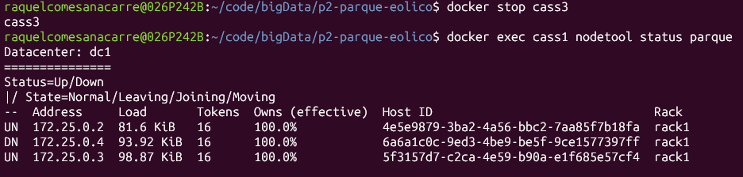
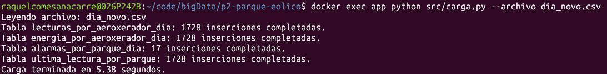
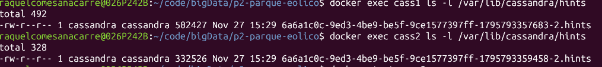
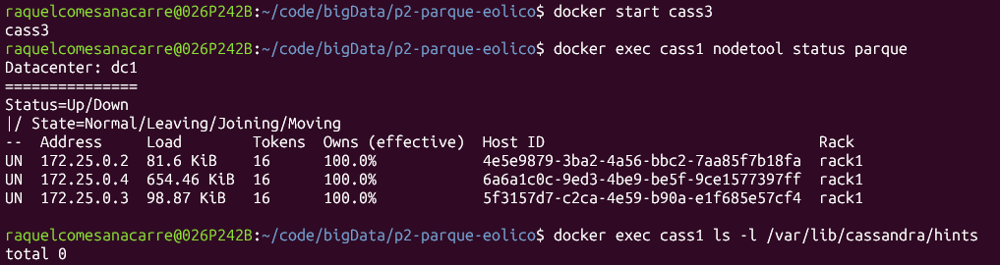
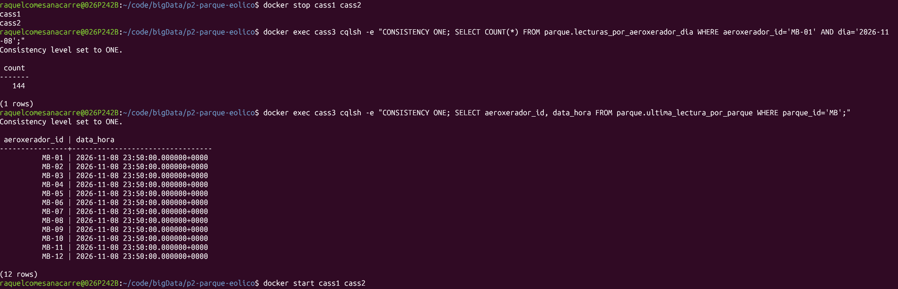

# P2. Parque eólico de Monte Brañas

Big Data Aplicado · UD1 · Proyecto en grupo

## Equipo

| Persona | Issues | Perfil |
|---|---|---|
| A - Raúl | 1 y 7 | Infraestructura |
| B - Raquel | 2 y 6 | Datos |
| C - Isma | 3 y 5 | Modelo y consistencia |
| D - Carlos | 4 y 8 | Aplicación y presentación |

## Cómo arrancar y ejecutar

### 1. Clúster de Cassandra (3 nodos)

```bash
docker compose up -d          # arranca cass1 (semilla), cass2 y cass3, uno tras otro
docker compose ps             # esperar a que los tres estén "healthy" (2-4 min)
```

Cada nodo tiene su volumen (`cass1_data`, `cass2_data`, `cass3_data`), así que los datos sobreviven a `docker compose down`. Para empezar de cero: `docker compose down -v`.

Comprobar que los tres nodos están `UN` (Up/Normal):

```bash
docker exec cass1 nodetool status
```

### 2. Keyspace (3 réplicas, `NetworkTopologyStrategy`)

```bash
docker exec -i cass1 cqlsh < cql/01_keyspace.cql
docker exec cass1 cqlsh -e "DESCRIBE KEYSPACE parque"
```

### 3. Contenedor `app` (Python + cassandra-driver)

Desde Windows el driver no ve las IP internas de Docker, por eso los scripts se ejecutan en un contenedor de la misma red. El servicio tiene el perfil `app`:

```bash
docker compose --profile app up -d --build app
docker compose exec app python src/<script>.py
docker compose exec app bash        # shell interactivo
```

Dentro del contenedor, los nodos son accesibles como `cass1`, `cass2` y `cass3` (también en la variable `CASSANDRA_HOSTS`).

### 4. Generador de lecturas (`src/xera_lecturas.py`)        

Como no tenemos acceso al SCADA, las lecturas se generan con un script que cumple siempre el contrato de datos (apartado 2).

```bash
python3 src/xera_lecturas.py --dias 7 --inicio 2026-11-01 --semilla 42 --salida lecturas.csv
```

| Parámetro | Por defecto | Para qué |
|---|---|---|
| `--dias` | 7 | número de días (7 para el conjunto principal; 1 para el día nuevo de 4.3.4) |
| `--inicio` | 2026-11-01 | primer día |
| `--semilla` | 42 | misma semilla = mismos datos |
| `--salida` | lecturas.csv | fichero CSV |

Con 7 días salen 12 × 144 × 7 = **12.096 lecturas**. El CSV no se sube al repo: se puede volver a generar con la semilla.

Cómo cumple las reglas:
- **Regla 1:** una lectura cada 10 minutos para cada aerogenerador, 144 al día, sin huecos ni repeticiones.
- **Regla 2:** potencia 0 con viento < 3 o > 25 m/s; sube entre 3 y 12; unos 3.000 kW entre 12 y 25.
- **Regla 3:** `parado` con 0 kW y 0 rpm; `alarma` en un 1 % de las lecturas (temperatura alta); `ok` el resto.
- **Regla 4:** hay un viento general del parque que cambia poco cada 10 minutos, y cada aerogenerador tiene un viento parecido a él.

Antes de guardar, el script **comprueba el contrato** (rangos, 144 lecturas por aerogenerador y día, sin duplicados, parados con 0 kW y 0 rpm). Si algo falla, no guarda nada y muestra el error.


## Modelo de datos (4.1)

Esquema completo en [`cql/02_tablas.cql`](cql/02_tablas.cql). Se crea después del keyspace:

```bash
docker exec -i cass1 cqlsh < cql/02_tablas.cql
docker exec cass1 cqlsh -e "DESCRIBE TABLES" -k parque
```

### Por qué una tabla por consulta

En Cassandra no hay `JOIN` y solo se puede filtrar de forma eficiente por la **clave de partición**. Por eso se parte de las consultas, no de las entidades: cada tabla guarda los datos ya agrupados (partición) y ordenados (columnas de agrupación) como los pide su consulta, y así cada consulta lee **una sola partición** en un solo nodo. El precio es duplicar datos (cada lectura se escribe en varias tablas), que en Cassandra es barato: escribir es rápido y el disco es lo que sobra.

### Columnas derivadas

Además de los campos del contrato, `carga.py` calcula dos columnas para poder usarlas en las claves:

| Columna | Tipo CQL | Cómo se calcula | Para qué |
|---|---|---|---|
| `dia` | `date` | la fecha de `data_hora` (`"2026-11-01 00:10:00"[:10]`) | partir por día: las particiones no crecen sin límite |
| `parque_id` | `text` | prefijo de `aeroxerador_id` (`"MB-07"` → `"MB"`) | preparado para más parques (consultas 3 y 4) |

### Las cuatro tablas

| # | Consulta | Tabla | Clave de partición | Columnas de agrupación | Filas por partición |
|---|---|---|---|---|---|
| 1 | Lecturas de un aerogenerador en un día (recientes primero) | `lecturas_por_aeroxerador_dia` | `(aeroxerador_id, dia)` | `data_hora DESC` | 144 |
| 2 | Energía de un aerogenerador en un día | `energia_por_aeroxerador_dia` | `(aeroxerador_id, dia)` | `data_hora` | 144 |
| 3 | Alarmas de un día en todo el parque (orden horario) | `alarmas_por_parque_dia` | `(parque_id, dia)` | `data_hora ASC, aeroxerador_id ASC` | ~17 (máx. 1.728) |
| 4 | Última lectura de cada aerogenerador | `ultima_lectura_por_parque` | `parque_id` | `aeroxerador_id` | 12 |


**1. `lecturas_por_aeroxerador_dia`**
- *Partición `(aeroxerador_id, dia)`*: la consulta siempre da un aerogenerador y un día, así que todas sus lecturas están juntas en una partición. Si la partición fuese solo `aeroxerador_id`, crecería sin límite (52.560 filas al año, y sigue).
- *Agrupación `data_hora DESC`*: identifica cada lectura dentro del día (no hay dos con la misma hora, regla 1) y las guarda ya de la más reciente a la más antigua, sin ordenar al leer.

```sql
SELECT * FROM lecturas_por_aeroxerador_dia WHERE aeroxerador_id = 'MB-01' AND dia = '2026-11-01';
```

**2. `energia_por_aeroxerador_dia`**
- Guarda solo la potencia de cada intervalo de 10 minutos. La energía es `SUM(potencia_kw) × 10/60` kWh; Cassandra hace la suma dentro de una sola partición.
- *Partición `(aeroxerador_id, dia)`*: la que pide la consulta.
- *Agrupación `data_hora`*: una fila por intervalo. Si se carga dos veces el mismo CSV, cada `INSERT` sobrescribe la misma fila (upsert) y **la energía no se duplica**. Por eso se descartó una tabla `counter`: sumar dos veces la misma lectura daría una energía falsa, y además los contadores no admiten decimales.

```sql
SELECT SUM(potencia_kw) AS suma_kw FROM energia_por_aeroxerador_dia WHERE aeroxerador_id = 'MB-01' AND dia = '2026-11-01';
-- energía_kwh = suma_kw * 10 / 60   (se calcula en consultas.py)
```

**3. `alarmas_por_parque_dia`**
- Solo se insertan las lecturas con `estado = 'alarma'`.
- *Partición `(parque_id, dia)`*: la consulta pide un día de todo el parque, sin aerogenerador concreto. Con `parque_id`, cuando lleguen más parques cada uno tendrá sus propias particiones y no se mezclarán.
- *Agrupación `data_hora ASC, aeroxerador_id ASC`*: `data_hora` da el orden horario; `aeroxerador_id` hace falta porque dos aerogeneradores pueden dar alarma a la misma hora, y con solo `data_hora` la segunda sobrescribiría a la primera.

```sql
SELECT * FROM alarmas_por_parque_dia WHERE parque_id = 'MB' AND dia = '2026-11-01';
```

**4. `ultima_lectura_por_parque`**
- *Partición `parque_id`*: el panel de control lee los 12 aerogeneradores de una vez, de una partición.
- *Agrupación `aeroxerador_id`*: una fila por aerogenerador que se **sobrescribe** con cada lectura nueva, así que nunca hay más de 12 filas.
- Se escribe con `USING TIMESTAMP` igual a `data_hora` en microsegundos. Cassandra se queda con la escritura de timestamp mayor, así que la fila guarda siempre la lectura más reciente **aunque los días se carguen desordenados** (por ejemplo, si se vuelve a cargar un día antiguo después del día del apartado 4.3.4).

```sql
SELECT * FROM ultima_lectura_por_parque WHERE parque_id = 'MB';
```

### Tamaño de las particiones al cabo de un año

Con 12 aerogeneradores, 144 lecturas por aerogenerador y día y ~1 % de alarmas:

| Tabla | Filas por partición | Particiones nuevas al año | Filas al año | ¿Crece la partición con el tiempo? |
|---|---|---|---|---|
| `lecturas_por_aeroxerador_dia` | 144 | 12 × 365 = 4.380 | 630.720 | No: cada día empieza una nueva |
| `energia_por_aeroxerador_dia` | 144 | 4.380 | 630.720 | No: cada día empieza una nueva |
| `alarmas_por_parque_dia` | ~17 (1 % de 1.728); máx. 1.728 | 365 por parque | ~6.200 | No: cada día empieza una nueva |
| `ultima_lectura_por_parque` | 12 | 1 por parque (siempre la misma) | 12 | No: las filas se sobrescriben |

Ninguna partición pasa de 1.728 filas (unos pocos cientos de KB como mucho), muy por debajo de lo que Cassandra maneja bien (~100 MB por partición). Lo que crece con los años es el **número** de particiones, y eso es justo lo que se reparte entre nodos: al añadir un nodo (4.4), se lleva parte de ellas.

### Del contrato de datos a CQL

| Campo | Contrato | Tipo CQL | Por qué |
|---|---|---|---|
| `aeroxerador_id` | texto, `MB-01`…`MB-12` | `text` | cadena corta; el prefijo identifica el parque |
| `data_hora` | fecha y hora, cada 10 min | `timestamp` | fecha y hora exactas (ms); se guarda en UTC y permite ordenar |
| `vento_ms` | decimal, 1 decimal, 0,0–30,0 | `decimal` | guarda el valor exacto (8.7 es 8.7); con `float` saldría 8.699999… |
| `direccion_graos` | entero, 0–359 | `int` | número entero |
| `potencia_kw` | decimal, 1 decimal, 0,0–3.000,0 | `decimal` | exacto; además `SUM` de la consulta 2 no acumula errores de redondeo |
| `rotor_rpm` | decimal, 1 decimal, 0,0–16,0 | `decimal` | exacto |
| `temp_xerador_c` | decimal, 1 decimal, 10,0–90,0 | `decimal` | exacto |
| `estado` | `ok`, `alarma` o `parado` | `text` | CQL no tiene `enum`; los valores los garantiza el generador, que valida el contrato antes de guardar |

CQL no tiene `NOT NULL` ni `CHECK`: que los campos sean obligatorios y estén en rango lo comprueba el generador (`xera_lecturas.py`), que valida el contrato antes de escribir el CSV. Las columnas de la clave primaria sí son obligatorias: Cassandra rechaza un `INSERT` sin ellas.

### Notas para la carga (issue 4)

- Por cada lectura del CSV: `INSERT` en `lecturas_por_aeroxerador_dia`, `energia_por_aeroxerador_dia` y `ultima_lectura_por_parque` (esta con `USING TIMESTAMP`), y en `alarmas_por_parque_dia` solo si `estado == 'alarma'`.
- Los decimales se pasan como `decimal.Decimal(texto_del_csv)` (no `float`) para que se guarden exactos.
- `data_hora` se trata como UTC: `datetime.strptime(s, "%Y-%m-%d %H:%M:%S").replace(tzinfo=timezone.utc)`; `dia` es su `.date()`; el `USING TIMESTAMP` es `int(data_hora.timestamp() * 1_000_000)`.

## Carga de datos y consultas (4.2)

Una vez creadas las tablas (`cql/02_tablas.cql`) y generado `lecturas.csv`, cargar las lecturas en las cuatro tablas de Cassandra (inserción concurrente con sentencias preparadas):

    docker exec app python src/carga.py --archivo lecturas.csv

Ejecutar las cuatro consultas para un aerogenerador y un día concretos:

    docker exec app python src/consultas.py --aeroxerador MB-01 --dia 2026-11-01

Por defecto la consulta 1 imprime las 144 filas del día para que la comparación de archivos (`diff`) de la fase de crecimiento compruebe el 100 % de los datos. Para acortar la salida en pantalla se puede usar `--limite`:

    docker exec app python src/consultas.py --aeroxerador MB-01 --dia 2026-11-01 --limite 10

## Niveles de consistencia y pruebas de fallo (4.3)

### Niveles de consistencia (4.3.2)

El keyspace tiene 3 réplicas (RF = 3), y con 3 nodos cada partición está en los tres. El nivel de consistencia dice cuántas réplicas tienen que responder para dar una operación por buena:

| Nivel | Réplicas que responden (RF = 3) | Nodos parados que aguanta |
|---|---|---|
| `ONE` | 1 | 2 |
| `QUORUM` | 2 (3 // 2 + 1) | 1 |
| `ALL` | 3 | 0 |

Los niveles están en [`src/consistencia.py`](src/consistencia.py), y los usan `carga.py` (escrituras) y `consultas.py` (lecturas):

| Operación | Nivel | Por qué |
|---|---|---|
| Escribir lecturas | `QUORUM` | Cuando la carga da una lectura por guardada, ya está en **2 nodos**: si cae uno, la lectura sigue en otro y no se pierde (condición 2 del encargo). Con un nodo parado se puede seguir cargando. |
| Leer lecturas | `QUORUM` | Como se escribe en 2 réplicas y se lee de 2, siempre coinciden al menos en una (W + R = 2 + 2 > 3): **siempre se lee la última lectura confirmada**. Con un nodo parado las consultas siguen funcionando. |
| Escribir alarmas | `QUORUM` | Una alarma es lo que menos se puede perder, así que tiene que quedar en al menos 2 nodos. No se usa `ALL`, porque con un nodo parado fallaría la escritura y la alarma no se guardaría. |
| Leer alarmas | `QUORUM` | Con W + R > 3, una alarma ya confirmada **siempre aparece** en la consulta; con `ONE` podría leerse de la réplica que aún no la tiene. |

Por qué no los otros niveles:
- **`ONE`**: es el más rápido y aguanta 2 nodos parados, pero una escritura confirmada por un solo nodo se pierde si ese nodo falla antes de copiarla a los demás. Además, leer con `ONE` puede devolver datos viejos (la réplica que responde puede no tener la última escritura).
- **`ALL`**: siempre lee lo último, pero un solo nodo parado basta para que falle todo, que es justo lo que el encargo pide evitar.

El precio de `QUORUM` es que con **2 nodos parados** no funciona ni la carga ni las consultas (se ve abajo). Con 3 nodos es lo esperable: si se pierde la mayoría, Cassandra prefiere dar error a devolver datos que pueden no estar al día.

### Pruebas de fallo desde Python (4.3.3)

[`src/pruebas_fallo.py`](src/pruebas_fallo.py) hace una operación con el nivel que se le pida y muestra qué nodos están parados, cuántas réplicas pide ese nivel, cuántas están vivas y el resultado o el error:

```bash
docker stop cass3                      # parar un nodo (esperar ~10 s a que los demás lo vean caído)
docker exec app python src/pruebas_fallo.py --operacion escribir --nivel QUORUM
docker exec app python src/pruebas_fallo.py --operacion leer --nivel ALL --aeroxerador MB-01 --dia 2026-11-01
docker start cass3                     # volver a arrancarlo
```

- `--operacion escribir` guarda una lectura del aerogenerador de prueba `PROBA-01`, que no aparece en las consultas de la empresa (que son de `MB-01`…`MB-12`).
- `--operacion leer` cuenta las lecturas de un aerogenerador en un día (144 si está todo cargado).

#### Ejemplo 1 · funciona: 1 nodo parado, escribir con `QUORUM`

- **Nodos parados:** `cass3`
- **Operación y nivel:** escribir una lectura con `QUORUM`

```
=== Prueba de fallo ===
Nodos parados:          cass3
Operación:              escribir una lectura (PROBA-01, 2026-11-27 11:00)
Nivel de consistencia:  QUORUM
Réplicas de la partición: 3, vivas: 2
Réplicas que pide QUORUM: 2
--- Resultado ---
OK: escritura confirmada por al menos 2 réplica(s).
```

- **Explicación:** `QUORUM` necesita **2** réplicas y hay **2** vivas (`cass1` y `cass2`), así que la escritura se confirma. La copia de `cass3` no se pierde: el coordinador la guarda como *hint* y se la entrega cuando `cass3` vuelve. Es el caso de la condición 2 del encargo: cae un servidor y el servicio sigue funcionando.

#### Ejemplo 2 · falla: 2 nodos parados, leer con `ALL`

- **Nodos parados:** `cass2` y `cass3`
- **Operación y nivel:** leer las lecturas de `MB-01` el 2026-11-01 con `ALL`

```
=== Prueba de fallo ===
Nodos parados:          cass2, cass3
Operación:              leer las lecturas de MB-01 el 2026-11-01
Nivel de consistencia:  ALL
Réplicas de la partición: 3, vivas: 1
Réplicas que pide ALL: 3
--- Resultado ---
ERROR Unavailable: ALL necesita 3 réplicas y solo hay 1 vivas. Cassandra no lo intenta.
  Mensaje: Error from server: code=1000 [Unavailable exception] message="Cannot achieve consistency level ALL" info={'consistency': 'ALL', 'required_replicas': 3, 'alive_replicas': 1}
```

- **Explicación:** `ALL` necesita las **3** réplicas y solo hay **1** viva (`cass1`). El coordinador sabe por *gossip* que los otros dos están caídos, así que ni lo intenta: responde `Unavailable` enseguida, sin esperar a ningún *timeout*. Los datos siguen en `cass1`, pero no se pueden leer con la garantía que pide `ALL`.

#### Todas las combinaciones

Para completar, se lanzaron las dos operaciones con los tres niveles, con 1 y con 2 nodos parados (salidas reales del script):

| Nodos parados | Réplicas vivas | `ONE` (pide 1) | `QUORUM` (pide 2) | `ALL` (pide 3) |
|---|---|---|---|---|
| 1 (`cass3`) | 2 | ✅ escribe y lee | ✅ escribe y lee | ❌ `Unavailable` |
| 2 (`cass2`, `cass3`) | 1 | ✅ escribe y lee | ❌ `Unavailable` | ❌ `Unavailable` |

La regla siempre es la misma: **funciona si las réplicas vivas son al menos las que pide el nivel**. Con nuestros niveles (`QUORUM`), el sistema aguanta 1 nodo parado, pero no 2.

> Con 2 nodos parados, el driver reintenta la operación en otro nodo y, como los demás también están caídos, devuelve un `NoHostAvailable` que lleva dentro el `Unavailable` del nodo vivo. El script lo saca de ahí para mostrar la causa real.

### Nodo caído: cargar un día y comprobar la recuperación (4.3.4) 

Con `cass3` parado se carga un día nuevo (2026-11-08); al arrancarlo de nuevo se comprueba que tiene esas lecturas.

**1. Generar el día nuevo** (otra semilla, para que no sea igual al primer día):

```bash
python3 src/xera_lecturas.py --dias 1 --inicio 2026-11-08 --semilla 7 --salida dia_novo.csv
```

**2. Parar `cass3`** y comprobar que aparece `DN`:

```bash
docker stop cass3
docker exec cass1 nodetool status parque
```
```
UN  172.25.0.2  81.6 KiB   16  100.0%  4e5e9879-...  rack1
DN  172.25.0.4  93.92 KiB  16  100.0%  6a6a1c0c-...  rack1   = cass3
UN  172.25.0.3  98.87 KiB  16  100.0%  5f3157d7-...  rack1
```


**3. Cargar el día con `cass3` caído.** Funciona porque la carga escribe con `QUORUM` (2 réplicas) y quedan 2 vivas:

```bash
docker exec app python src/carga.py --archivo dia_novo.csv
```
```
Tabla lecturas_por_aeroxerador_dia: 1728 inserciones completadas.
Tabla energia_por_aeroxerador_dia: 1728 inserciones completadas.
Tabla alarmas_por_parque_dia: 17 inserciones completadas.
Tabla ultima_lectura_por_parque: 1728 inserciones completadas.
```


**4. Los hints.** Cada nodo que coordinó escrituras guarda la parte de `cass3` en un fichero de *hints*, cuyo nombre empieza por el Host ID de `cass3` (`6a6a1c0c-…`):

```bash
docker exec cass1 ls -l /var/lib/cassandra/hints
docker exec cass2 ls -l /var/lib/cassandra/hints
```
```
cass1: 502427 bytes  6a6a1c0c-9ed3-4be9-be5f-9ce1577397ff-1795793357683-2.hints
cass2: 332526 bytes  6a6a1c0c-9ed3-4be9-be5f-9ce1577397ff-1795793359458-2.hints
```


> `nodetool listpendinghints` decía *"no pending hints"*: mientras el nodo destino está caído, el fichero sigue abierto, y ese comando solo muestra los ficheros ya cerrados y listos para enviar. Por eso se comprueba mirando la carpeta.

**5. Arrancar `cass3`.** Vuelve a `UN`, su `Load` pasa de 93,92 KiB a **654,46 KiB** (lo que ha recibido) y las carpetas de hints quedan vacías (`total 0`): se le han entregado.

```bash
docker start cass3
docker exec cass1 nodetool status parque
docker exec cass1 ls -l /var/lib/cassandra/hints   # total 0
```



**6. Comprobación: `cass3` tiene los datos él solo.** Se paran `cass1` y `cass2`, así solo puede responder `cass3`:

```bash
docker stop cass1 cass2
docker exec cass3 cqlsh -e "CONSISTENCY ONE; SELECT COUNT(*) FROM parque.lecturas_por_aeroxerador_dia WHERE aeroxerador_id='MB-01' AND dia='2026-11-08';"
docker exec cass3 cqlsh -e "CONSISTENCY ONE; SELECT aeroxerador_id, data_hora FROM parque.ultima_lectura_por_parque WHERE parque_id='MB';"
docker start cass1 cass2
```
```
-- Consulta 1: lecturas de MB-01 el día 8
 count
-------
   144

-- Consulta 2: última lectura de cada aerogenerador
 aeroxerador_id | data_hora
----------------+---------------------------------
          MB-01 | 2026-11-08 23:50:00.000000+0000
          MB-02 | 2026-11-08 23:50:00.000000+0000
          MB-03 | 2026-11-08 23:50:00.000000+0000
          MB-04 | 2026-11-08 23:50:00.000000+0000
          MB-05 | 2026-11-08 23:50:00.000000+0000
          MB-06 | 2026-11-08 23:50:00.000000+0000
          MB-07 | 2026-11-08 23:50:00.000000+0000
          MB-08 | 2026-11-08 23:50:00.000000+0000
          MB-09 | 2026-11-08 23:50:00.000000+0000
          MB-10 | 2026-11-08 23:50:00.000000+0000
          MB-11 | 2026-11-08 23:50:00.000000+0000
          MB-12 | 2026-11-08 23:50:00.000000+0000
```


**Cómo recibió `cass3` las lecturas: *hinted handoff*.** Al escribir con `cass3` caído, el coordinador guarda la escritura en las réplicas vivas y además apunta un *hint* ("esto era para `cass3`"). Cuando `cass3` vuelve, el *gossip* avisa a los demás y estos le entregan los hints.

Los hints solo se guardan durante **3 horas** (`max_hint_window`). Si un nodo está caído más tiempo, hay que sincronizarlo con `nodetool repair`.

>  NOTA: Durante las pruebas de fallo usar solo `docker exec`, nunca `docker compose up`: arrancaría de nuevo los nodos parados (el servicio `app` depende de ellos).


## Crecimiento del clúster (4.4)


Se añade un cuarto nodo (`cass4`) con el clúster funcionando, **sin cargar más datos** a partir de aquí. `cass4` está en el perfil `ampliar` de `compose.yaml`, así que `docker compose up -d` normal no lo arranca.

### 1. Consultas antes de crecer

Con los 3 nodos en marcha y todo cargado (incluido el día de la prueba de nodo caído), se ejecutan las consultas y se guarda la salida. Los parámetros deben ser los mismos antes y después:

```bash
for n in cass1 cass2 cass3; do docker exec $n nodetool flush parque; done   # pasa la memoria a disco para que el Load sea real
docker exec cass3 nodetool status parque
docker exec app python src/consultas.py --aeroxerador MB-01 --dia 2026-11-08 > consultas_antes.txt
```

`nodetool status parque` (con el nombre del keyspace) hace que *Owns* tenga en cuenta el factor de replicación 3.

```
Datacenter: dc1
--  Address     Load        Tokens  Owns (effective)  Host ID       Rack
UN  172.18.0.4  662.71 KiB  16      100.0%            4cf0d8b5-...  rack1
UN  172.18.0.3  662.69 KiB  16      100.0%            be36c737-...  rack1
UN  172.18.0.2  650.41 KiB  16      100.0%            32acca16-...  rack1
```

### 2. Añadir `cass4` sin parar el clúster

```bash
docker compose --profile ampliar up -d cass4     # no toca cass1-3 (ya están en marcha)
docker exec cass1 nodetool status parque          # repetir hasta que cass4 pase de UJ (Joining) a UN
```

`cass4` arranca con `CASSANDRA_SEEDS=cass1`, contacta con el clúster, recibe un rango de tokens y los demás nodos le *transmiten* (streaming) los datos que ahora le corresponden. Durante ese tiempo aparece como `UJ` (Up/Joining).

```
Datacenter: dc1
--  Address     Load        Tokens  Owns (effective)  Host ID       Rack
UN  172.18.0.4  662.71 KiB  16      77.4%             4cf0d8b5-...  rack1
UN  172.18.0.6  548.34 KiB  16      73.2%             b2f1fefc-...  rack1   = cass4
UN  172.18.0.3  662.69 KiB  16      74.7%             be36c737-...  rack1
UN  172.18.0.2  650.41 KiB  16      74.7%             32acca16-...  rack1

(Load de los nodos antiguos sin cambios: todavía no se ha hecho el cleanup.)
```

### 3. `nodetool cleanup` en los nodos antiguos

```bash
docker exec cass1 nodetool cleanup parque
docker exec cass2 nodetool cleanup parque
docker exec cass3 nodetool cleanup parque
docker exec cass4 nodetool status parque
```

**Qué hace `cleanup`:** al entrar `cass4`, los nodos antiguos dejan de ser réplica de parte de sus rangos de tokens, pero **siguen guardando esos datos** en disco (Cassandra no los borra automáticamente al hacer streaming). `nodetool cleanup` reescribe los SSTables y elimina las particiones que el nodo ya no posee, liberando espacio. No cambia lo que devuelven las consultas, solo el *Load* de los nodos antiguos. Hay que ejecutarlo en cada nodo antiguo, y no en `cass4`.

```
Datacenter: dc1
--  Address     Load        Tokens  Owns (effective)  Host ID       Rack
UN  172.18.0.4  532.92 KiB  16      77.4%             4cf0d8b5-...  rack1
UN  172.18.0.6  514.33 KiB  16      73.2%             b2f1fefc-...  rack1   = cass4
UN  172.18.0.3  524.71 KiB  16      74.7%             be36c737-...  rack1
UN  172.18.0.2  525.26 KiB  16      74.7%             32acca16-...  rack1

(salida tomada desde cass4: el Load de cada nodo tarda un poco en propagarse por gossip)
```

| Nodo | Load antes | Owns antes | Load después | Owns después |
|------|-----------|-----------|--------------|--------------|
| cass1 (172.18.0.2) | 650,41 KiB | 100 % | 525,26 KiB | 74,7 % |
| cass2 (172.18.0.3) | 662,69 KiB | 100 % | 524,71 KiB | 74,7 % |
| cass3 (172.18.0.4) | 662,71 KiB | 100 % | 532,92 KiB | 77,4 % |
| cass4 (172.18.0.6) | – | – | 514,33 KiB | 73,2 % |

### 4. Consultas después y comparación

```bash
docker exec app python src/consultas.py --aeroxerador MB-01 --dia 2026-11-08 > consultas_despois.txt
diff consultas_antes.txt consultas_despois.txt && echo "IGUALES"
```

```
IGUALES   (186 líneas en cada fichero, 144 lecturas en la consulta 1)
```

Los datos no cambian: solo se han redistribuido entre los 4 nodos.

**Conclusión.** Con factor de replicación 3, cada dato está en 3 de los nodos. Con 3 nodos cada uno tenía el 100 %; con 4, cada uno tiene ~75 % (3/4). El *Owns* se reparte casi por igual y el *Load* de los nodos antiguos baja ~20 % tras el `cleanup`. Las consultas devuelven exactamente lo mismo. Antes de medir se hizo `nodetool flush` para que el *Load* reflejara los SSTables en disco y no solo la memoria.
